# AttributionIQ — Normalized MySQL Database Design & Schema Documentation

Database Engine: **MySQL 9.1** (`CHARACTER SET utf8mb4`, `COLLATE utf8mb4_unicode_ci`, `STRICT_TRANS_TABLES`)

---

## 1. Entity-Relationship Diagram

```mermaid
erDiagram
    auth_user ||--o| accounts_user_profile : "has profile"
    channels_channel ||--o{ campaigns_campaign : "hosts"
    auth_user ||--o{ campaigns_campaign : "creates"
    campaigns_campaign ||--o{ campaigns_status_history : "logs transitions"

    campaigns_campaign ||--o{ campaigns_campaign_creative : "uses"
    creatives_creative ||--o{ campaigns_campaign_creative : "assigned to"
    campaigns_campaign ||--o{ campaigns_campaign_audience : "targets"
    audiences_audience ||--o{ campaigns_campaign_audience : "targeted by"

    contacts_contact ||--o{ contacts_lifecycle_history : "tracks lifecycle"
    contacts_contact ||--o{ web_sessions_session : "initiates"
    campaigns_campaign ||--o{ web_sessions_session : "drives"

    contacts_contact ||--o{ touchpoints_touchpoint : "generates"
    campaigns_campaign ||--o{ touchpoints_touchpoint : "tagged on"
    channels_channel ||--o{ touchpoints_touchpoint : "via"
    creatives_creative ||--o{ touchpoints_touchpoint : "uses"
    web_sessions_session ||--o{ touchpoints_touchpoint : "linked to"

    contacts_contact ||--o{ leads_lead : "becomes"
    campaigns_campaign ||--o{ leads_lead : "sources"
    leads_lead ||--o{ leads_status_history : "tracks"

    leads_lead ||--o{ opportunities_opportunity : "qualifies into"
    contacts_contact ||--o{ opportunities_opportunity : "associated with"
    opportunities_opportunity ||--o{ opportunities_stage_history : "tracks"

    opportunities_opportunity ||--o{ orders_order : "closes as"
    contacts_contact ||--o{ orders_order : "places"

    campaigns_campaign ||--o{ costs_cost_record : "incurs"
    channels_channel ||--o{ costs_cost_record : "allocated to"

    attribution_model ||--o{ attribution_run : "executed in"
    auth_user ||--o{ attribution_run : "triggered by"
    attribution_run ||--o{ attribution_result : "produces"
    orders_order ||--o{ attribution_result : "attributed"
    touchpoints_touchpoint ||--o{ attribution_result : "credited"
    campaigns_campaign ||--o{ attribution_result : "receives credit"
    channels_channel ||--o{ attribution_result : "receives credit"
    contacts_contact ||--o{ attribution_result : "belongs to"

    validation_run ||--o{ validation_check_result : "contains checks"
    auth_user ||--o{ exceptions_data_exception : "resolves"
    auth_user ||--o{ audit_log : "performs"
```

---

## 2. Deterministic ID Generation Strategy

All domain tables use non-sequential-guessable, human-traceable deterministic primary keys generated atomically via `common.sequences.generate_deterministic_id` and `audit_id_sequence` (`SELECT ... FOR UPDATE` inside `transaction.atomic()`):

| Entity | Table | Primary Key Format | Max Length |
| :--- | :--- | :--- | :---: |
| User Profile | `accounts_user_profile` | `user_code`: `USR-2026-0001` (`id`: Auto BigInt) | 24 |
| Channel | `channels_channel` | `CHN-2026-000001` | 32 |
| Audience | `audiences_audience` | `AUD-2026-000001` | 32 |
| Campaign | `campaigns_campaign` | `CMP-2026-000001` | 32 |
| Creative | `creatives_creative` | `CRT-2026-000001` | 32 |
| Contact | `contacts_contact` | `CON-2026-000001` | 32 |
| Web Session | `web_sessions_session` | `SES-2026-000001` | 32 |
| Touchpoint | `touchpoints_touchpoint` | `TOUCH-<contact-id>-000001` | 48 |
| Lead | `leads_lead` | `LEAD-2026-000001` | 32 |
| Opportunity | `opportunities_opportunity` | `OPP-2026-000001` | 32 |
| Order | `orders_order` | `ORD-2026-000001` | 32 |
| Cost Record | `costs_cost_record` | `COST-2026-000001` | 32 |
| Attribution Run | `attribution_run` | `ATTR-RUN-2026-000001` | 40 |
| Attribution Result | `attribution_result` | `ATTR-RES-2026-000001` | 40 |
| Data Exception | `exceptions_data_exception` | `EXC-2026-000001` | 32 |
| Validation Run | `validation_run` | `VAL-RUN-2026-000001` | 40 |

---

## 3. Normalized Model Reference (Tables, Keys, Constraints & Indexes)

### A. Identity, Governance & Audit
1. **`accounts_user_profile`** (`apps.accounts.UserProfile`)
   - **PK**: `id` (BigAutoField); `user_id` (`OneToOneField -> auth_user.id`, `CASCADE`), `user_code` (`UNIQUE`).
   - **Fields**: `role` (`Admin` | `Marketing Manager` | `Marketing Analyst` | `Viewer`), `department`, `status` (`Active` | `Invited` | `Suspended`), `created_at`, `updated_at`.
   - **Indexes**: `idx_profile_role_status(role, status)`.
2. **`audit_id_sequence`** (`apps.audit.IdSequence`)
   - **PK**: `scope_key` (`VARCHAR(80)`), `last_value` (`INT UNSIGNED`), `created_at`, `updated_at`.
3. **`audit_log`** (`apps.audit.AuditLog`)
   - **PK**: `id`; `actor_id` (`FK -> auth_user`, `SET_NULL`, nullable).
   - **Fields**: `entity_type`, `entity_id`, `action`, `previous_state` (`JSON`), `new_state` (`JSON`), `changed_fields` (`JSON`), `source_ip`, `notes`, `created_at`.
   - **Indexes**: `idx_audit_entity(entity_type, entity_id)`, `idx_audit_action_ts(action, created_at)`.

### B. Marketing Management
4. **`channels_channel`** (`apps.channels.Channel`)
   - **PK**: `id`; `name` (`UNIQUE VARCHAR(120)`), `channel_type`, `status`, `owner`, `description`, timestamps.
   - **Indexes**: `idx_channel_type_status(channel_type, status)`.
5. **`audiences_audience`** (`apps.audiences.Audience`)
   - **PK**: `id`; `name` (`UNIQUE VARCHAR(150)`), `audience_type`, `estimated_size`, `criteria`, `status`, `effective_from`, `effective_to`, timestamps.
   - **Constraints**: `chk_audience_effective_dates` (`effective_to IS NULL OR effective_from IS NULL OR effective_to >= effective_from`).
6. **`campaigns_campaign`** (`apps.campaigns.Campaign`)
   - **PK**: `id`; `channel_id` (`FK -> channels_channel`, `PROTECT`), `created_by_id` (`FK -> auth_user`, `SET_NULL`, nullable).
   - **Fields**: `name`, `description`, `budget` (`DECIMAL(14,2)`), `currency` (`USD`/`EUR`/`GBP`), `start_date`, `end_date`, `objective`, `status`, `is_paid_campaign`, timestamps.
   - **M2M Relations**: `creatives` via **`campaigns_campaign_creative`** (`uq_campaign_creative_pair`); `audiences` via **`campaigns_campaign_audience`** (`uq_campaign_audience_pair`).
   - **History**: **`campaigns_status_history`** (`idx_cmp_hist_ts`).
   - **Constraints & Indexes**: `chk_campaign_budget_nonneg`, `chk_campaign_valid_date_range`, `idx_campaign_channel_status`, `idx_campaign_dates`.
7. **`creatives_creative`** (`apps.creatives.Creative`)
   - **PK**: `id`; `primary_campaign_id` (`FK -> campaigns_campaign`, `SET_NULL`, nullable).
   - **Constraints & Indexes**: `chk_creative_valid_dates`, `idx_creative_type_status`.

### C. Customer Tracking & Sessions
8. **`contacts_contact`** (`apps.contacts.Contact`)
   - **PK**: `id`; `email` (`UNIQUE`), `name`, `phone`, `company`, `source`, `created_date`, `lifecycle_status`, timestamps.
   - **History**: **`contacts_lifecycle_history`** (`idx_con_lc_hist_ts`).
9. **`web_sessions_session`** (`apps.web_sessions.WebSession`)
   - **PK**: `id`; `contact_id` (`FK -> contacts_contact`, `SET_NULL`, nullable), `campaign_id` (`FK -> campaigns_campaign`, `SET_NULL`, nullable).
   - **Fields**: `anonymous_id`, `landing_page`, `referrer`, `timestamp`, `device_type`, `identity_status` (`Identified` | `Anonymous` | `Unverified Link`), `has_evidence`, `evidence_type`, `linking_issue`.
   - **Indexes**: `idx_session_contact_ts`, `idx_session_identity(identity_status, has_evidence)`.
10. **`touchpoints_touchpoint`** (`apps.touchpoints.Touchpoint`)
    - **PK**: `id` (`TOUCH-<contact-id>-000001`).
    - **FKs**: `contact_id` (`PROTECT`), `campaign_id` (`SET_NULL`, nullable), `channel_id` (`PROTECT`, nullable), `creative_id` (`SET_NULL`, nullable), `session_id` (`SET_NULL`, nullable).
    - **Fields**: `interaction_type`, `timestamp`, `device`, `is_online`, `source`, `is_post_conversion`, `is_valid`, `validation_notes`.
    - **Indexes**: `idx_tp_contact_ts`, `idx_tp_campaign_ts`, `idx_tp_validity(is_valid, is_post_conversion)`.

### D. Sales & Financial Ledger
11. **`leads_lead`** (`apps.leads.Lead`) & **`leads_status_history`**
    - **PK**: `id`; `contact_id` (`PROTECT`), `campaign_id` (`SET_NULL`, nullable), `source`, `score`, `created_date`, `status`, `converted_at`.
    - **Constraints**: `chk_lead_score_range` (`score BETWEEN 0 AND 100`).
12. **`opportunities_opportunity`** (`apps.opportunities.Opportunity`) & **`opportunities_stage_history`**
    - **PK**: `id`; `lead_id` (`PROTECT`), `contact_id` (`PROTECT`), `stage` (6 stages), `expected_revenue` (`DECIMAL(14,2)`), `actual_revenue` (`DECIMAL(14,2)`), `closing_date`, `status`.
    - **Constraints**: `chk_opp_expected_rev_nonneg`, `chk_opp_actual_rev_nonneg`.
13. **`orders_order`** (`apps.orders.Order`)
    - **PK**: `id`; `opportunity_id` (`FK -> opportunities_opportunity`, `PROTECT`, non-unique to allow anomaly quarantine), `contact_id` (`PROTECT`), `order_date`, `revenue` (`DECIMAL(14,2)`), `currency`, `payment_status`, `verification_status`.
    - **Constraints & Indexes**: `chk_order_revenue_nonneg`, `idx_order_verif_pay_date`, `idx_order_contact_date`.
14. **`costs_cost_record`** (`apps.costs.CostRecord`)
    - **PK**: `id`; `campaign_id` (`PROTECT`), `channel_id` (`PROTECT`, nullable), `category`, `amount` (`DECIMAL(14,2)`), `currency`, `spend_date`, `description`.
    - **Constraints & Indexes**: `chk_cost_amount_nonneg`, `idx_cost_campaign_curr`, `idx_cost_date_cat`.

### E. Attribution, Exceptions & Validation
15. **`attribution_model`** (`apps.attribution.AttributionModel`): `id` (`first_touch`, `last_touch`, `linear`, `time_decay`, `position_based`), `name`, `short_label`, `description`, `rule_version`, `config` (`JSON`), `is_active`.
16. **`attribution_run`** (`apps.attribution.AttributionRun`): `id`, `attribution_model_id` (`PROTECT`), `rule_version`, `period_label`, `conversion_window_days`, `half_life_days`, `valid_orders_processed`, `excluded_duplicate_orders`, `excluded_post_conversion_touches`, `total_attributed_revenue`, `status`, `executed_by_id`, `executed_at`.
17. **`attribution_result`** (`apps.attribution.AttributionResult`): `id`, `run_id` (`CASCADE`), `attribution_model_id` (`PROTECT`), `order_id` (`PROTECT`), `touchpoint_id` (`PROTECT`), `campaign_id` (`SET_NULL`), `channel_id` (`SET_NULL`), `contact_id` (`PROTECT`), `credit_weight` (`DECIMAL(7,6)`), `attributed_revenue` (`DECIMAL(14,2)`), `source_order_revenue` (`DECIMAL(14,2)`), `currency`, `calculated_at`.
    - **Constraints**: `chk_attr_res_weight_bounds` (`0 <= credit_weight <= 1`), `chk_attr_res_rev_nonneg`, `uq_attr_run_order_touch(run, order, touchpoint)`.
18. **`exceptions_data_exception`** (`apps.exceptions.DataException`): `id`, `issue_type`, `entity_type`, `entity_id`, `severity`, `description`, `expected_decision`, `actual_decision`, `resolution_status`, `created_date`, `resolved_at`, `resolved_by_id`, `resolution_notes`.
19. **`validation_run`** & **`validation_check_result`**: Stores validation run summaries and per-rule pass/fail/warning metrics (`uq_val_run_check_code`).

