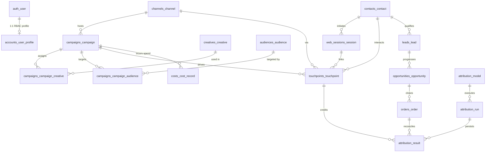

# AttributionIQ — Database Design & Schema Reference

- **Engine:** MySQL 9.1 (`utf8mb4` / `utf8mb4_unicode_ci` / `STRICT_TRANS_TABLES`)
- **Initialization DDL:** `database/init_mysql.sql`
- **Reference Diagram:** `database/schema_documentation.md`

---

## 1. Entity-Relationship Architecture

---

## 2. Deterministic ID Generation (`audit_id_sequence`)
Every primary business table uses human-readable deterministic primary keys stored in `audit_id_sequence(scope_key, last_value)` locked via `SELECT ... FOR UPDATE` inside `transaction.atomic()` (`common.sequences`):

| Entity | Table Name | ID Pattern |
| :--- | :--- | :--- |
| User Profile | `accounts_user_profile` | `USR-YYYY-NNNN` (`user_code`) |
| Channel | `channels_channel` | `CHN-2026-000001` |
| Campaign | `campaigns_campaign` | `CMP-2026-000001` |
| Creative | `creatives_creative` | `CRT-2026-000001` |
| Audience | `audiences_audience` | `AUD-2026-000001` |
| Contact | `contacts_contact` | `CON-2026-000001` |
| Web Session | `web_sessions_session` | `SES-2026-000001` |
| Touchpoint | `touchpoints_touchpoint` | `TOUCH-<contact-id>-000001` |
| Lead | `leads_lead` | `LEAD-2026-000001` |
| Opportunity | `opportunities_opportunity` | `OPP-2026-000001` |
| Order | `orders_order` | `ORD-2026-000001` |
| Cost Record | `costs_cost_record` | `COST-2026-000001` |
| Attribution Run | `attribution_run` | `ATTR-RUN-2026-000001` |
| Attribution Result | `attribution_result` | `ATTR-RES-2026-000001` |
| Data Exception | `exceptions_data_exception` | `EXC-2026-000001` |
| Validation Run | `validation_run` | `VAL-RUN-2026-000001` |

---

## 3. Integrity Constraints & Anomaly Quarantine Design
1. **Duplicate Revenue Protection:** `orders_order.opportunity_id` uses a indexed `ForeignKey` (`PROTECT`) paired with `verification_status` (`Valid` | `Duplicate` | `Invalid` | `Pending Review`) so duplicate ERP/checkout invoices are preserved for audit while quarantined from revenue & attribution sums.
2. **Identity Linking Evidence:** `web_sessions_session` stores `identity_status` (`Identified` | `Anonymous` | `Unverified Link`) and `has_evidence` so touchpoints derived from unverified probabilistic links are excluded from attribution credit.
3. **Financial Arithmetic Bounds:** Check constraints (`chk_campaign_budget_nonneg`, `chk_campaign_valid_date_range`, `chk_lead_score_range`, `chk_opp_expected_rev_nonneg`, `chk_opp_actual_rev_nonneg`, `chk_order_revenue_nonneg`, `chk_cost_amount_nonneg`, `chk_attr_res_weight_bounds`, `chk_attr_res_rev_nonneg`) enforce relational correctness at DB level.
4. **History & Audit Trail Tables:** `campaigns_status_history`, `contacts_lifecycle_history`, `leads_status_history`, `opportunities_stage_history`, and `audit_log` preserve immutable state-change logs.

